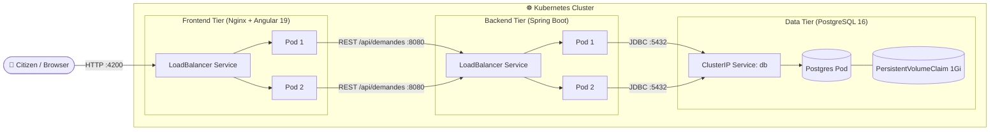
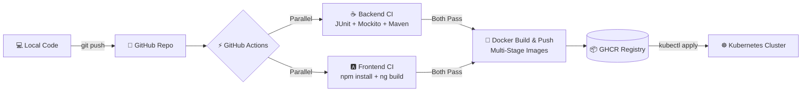

<div align="center">

# 🏛️ Consulat-App — Consular Request Tracker

**An end-to-end Full-Stack & DevOps reference project simulating a Consular Services platform — built from local code to CI/CD and Kubernetes.**


[Architecture](#-system-architecture) • [Delivery Pipeline](#-cicd--delivery-lifecycle) • [Phases Completed](#-engineering-roadmap-steps-completed) • [Quick Start](#-quick-start) • [Full Documentation](./DOCUMENTATION.md)

</div>

---

## 🏗️ System Architecture

The application follows a decoupled **3-Tier Architecture** containerized with Docker and orchestrated by **Kubernetes** for high availability, self-healing, and persistent storage.



---

## 🔄 CI/CD & Delivery Lifecycle

Every push to `dev` or `main` triggers an automated **GitHub Actions** pipeline that tests, builds, and publishes production images to **GitHub Container Registry (GHCR)**.



---

## ✅ Engineering Roadmap (Steps Completed)

| Phase | Milestone | Key Deliverables & Verification |
| :---: | :--- | :--- |
| **1** | **Project Structure & Git** | Monorepo layout (`backend/`, `frontend/`, `k8s/`), `.gitignore`, `main`/`dev` branching workflow. |
| **2** | **Spring Boot + PostgreSQL** | 3-Tier API (`Controller → Service → Repository → Entity`), env-based DB config, Postman API testing. |
| **3** | **Angular 19 Frontend** | Standalone components, `HttpClient` service, SSR `BootstrapContext` fix, live E2E browser testing. |
| **4** | **Docker & Docker Compose** | Multi-stage Dockerfiles (Maven/Temurin + Node/Nginx), bridge network, volume persistence testing. |
| **5** | **CI/CD Pipeline** | JUnit 5 + Mockito unit test, automated GitHub Actions workflow, published images on GHCR. |
| **6** | **Kubernetes Deployment** | `Deployment` (2 replicas), `Service`, `PVC` manifests, self-healing & horizontal scaling tests. |

> [!TIP]
> **Want the full step-by-step engineering log?**
> For every configuration file, terminal command, troubleshooting note, and test procedure used in Phases 1–6, read the complete [**`DOCUMENTATION.md`**](./DOCUMENTATION.md).

---

## 📂 Repository Structure

```text
consulat-app/
├── .github/workflows/ci-cd.yml   # Automated CI/CD pipeline (Test → Build → GHCR Push)
├── backend/                      # Spring Boot REST API + Unit Tests + Multi-Stage Dockerfile
├── frontend/                     # Angular 19 SPA + Nginx SPA config + Multi-Stage Dockerfile
├── k8s/                          # Kubernetes manifests (postgres.yaml, backend.yaml, frontend.yaml)
├── docker-compose.yml            # One-command local full-stack orchestration
├── DOCUMENTATION.md              # Detailed phase-by-phase technical documentation
└── README.md                     # Project overview
```

---

## 🚀 Quick Start

### Option 1: Docker Compose (Fastest Local Setup)
```bash
git clone [https://github.com/0ZEUS01/consulat-app.git](https://github.com/0ZEUS01/consulat-app.git)
cd consulat-app
docker compose up --build -d
```
- **Frontend UI:** `http://localhost:4200`
- **Backend API:** `http://localhost:8080/api/demandes`
- **Stop stack:** `docker compose down`

### Option 2: Kubernetes (Docker Desktop / Minikube)
```bash
kubectl apply -f k8s/
kubectl get pods
```
Once all 5 pods (`1 db + 2 backend + 2 frontend`) show `Running`, open `http://localhost:4200`.

```bash
# Test self-healing (Kubernetes recreates the deleted pod automatically)
kubectl delete pod <consulat-backend-pod-name>

# Test horizontal scaling
kubectl scale deployment consulat-backend --replicas=3
```

---

## 🔌 API Endpoints

| Method | Endpoint | Description |
| :--- | :--- | :--- |
| `GET` | `/api/demandes` | Retrieve all consular requests |
| `POST` | `/api/demandes` | Create a new request (auto-assigns `statut: "EN_ATTENTE"`) |

```json
// Example POST /api/demandes payload
{
  "cin": "AB12345",
  "typeDocument": "Passeport"
}
```

---

## 📖 Documentation

For a deep dive into the architecture decisions, code locations, testing types (Unit, API, E2E, Smoke, Persistence, Chaos), and troubleshooting fixes, visit [**`DOCUMENTATION.md`**](./DOCUMENTATION.md).
